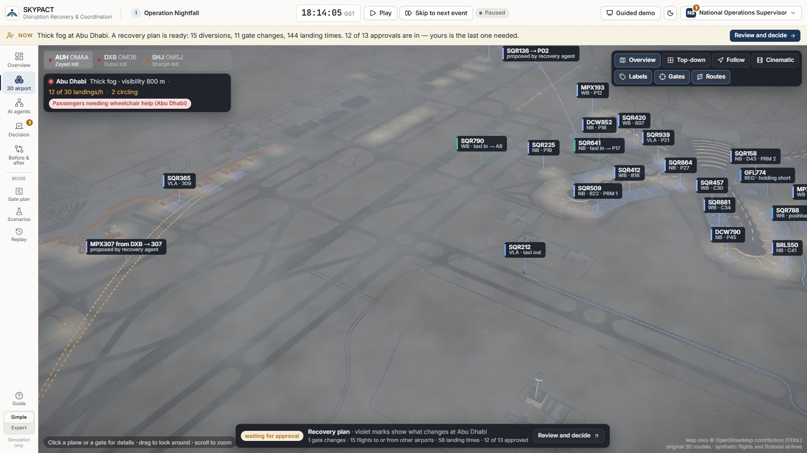
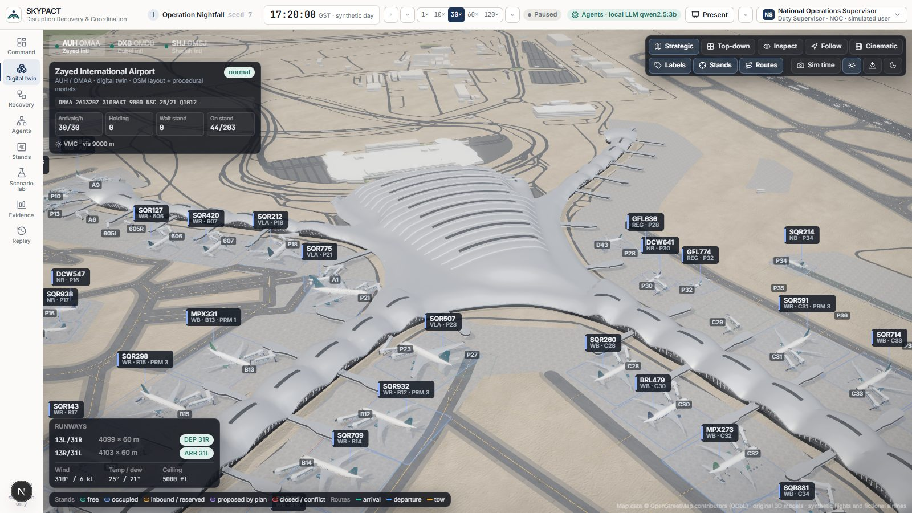
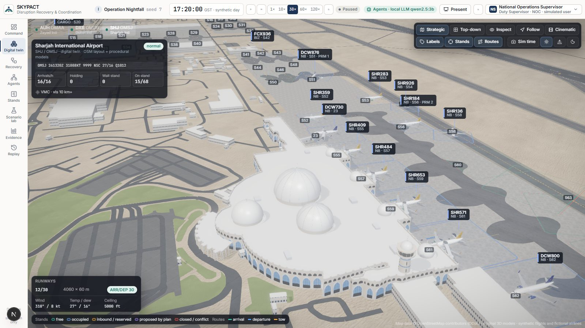
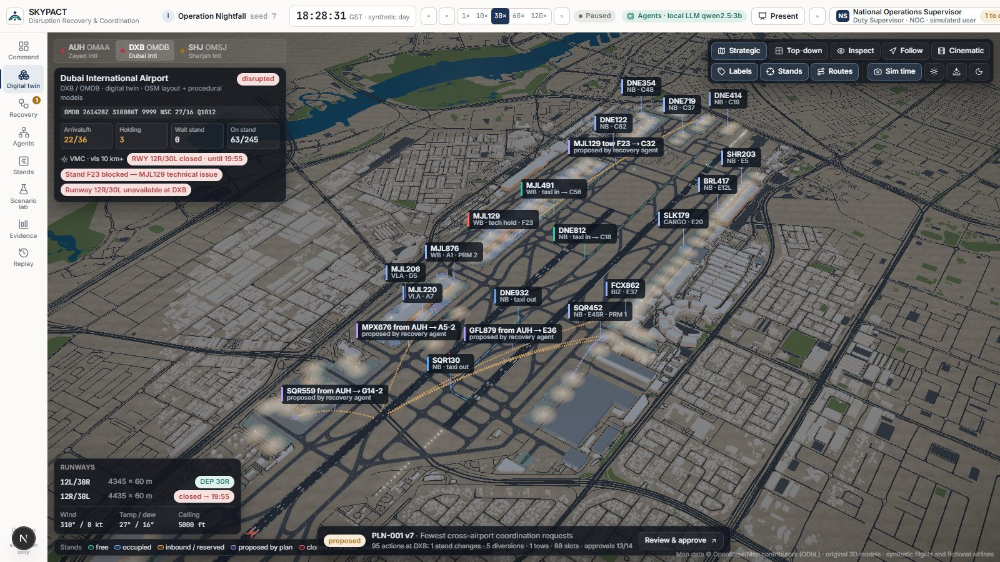
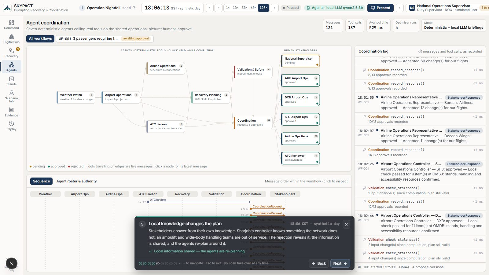
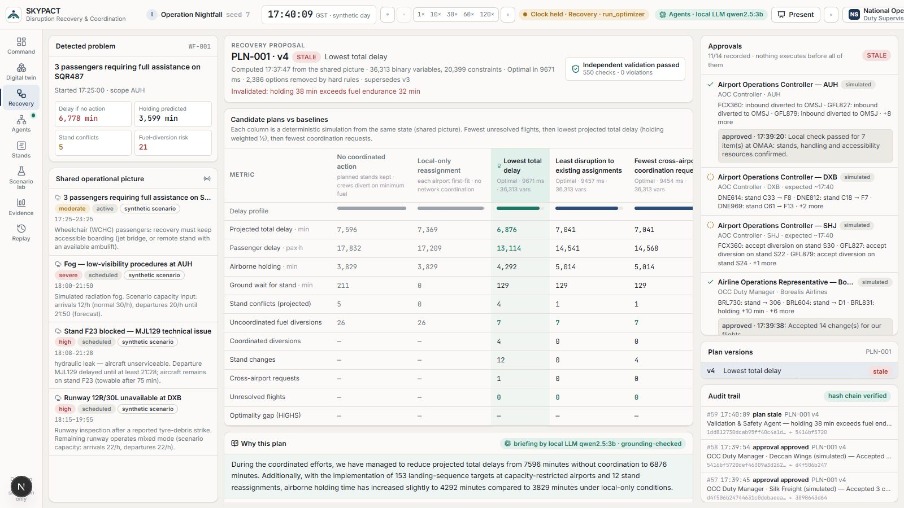
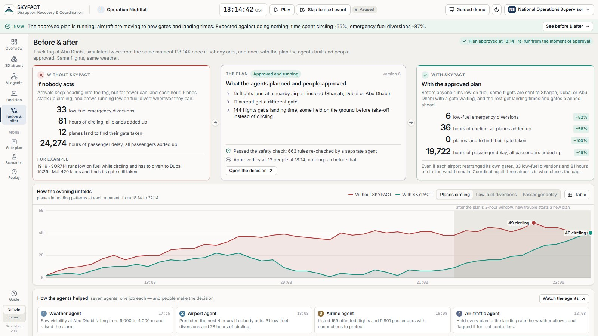
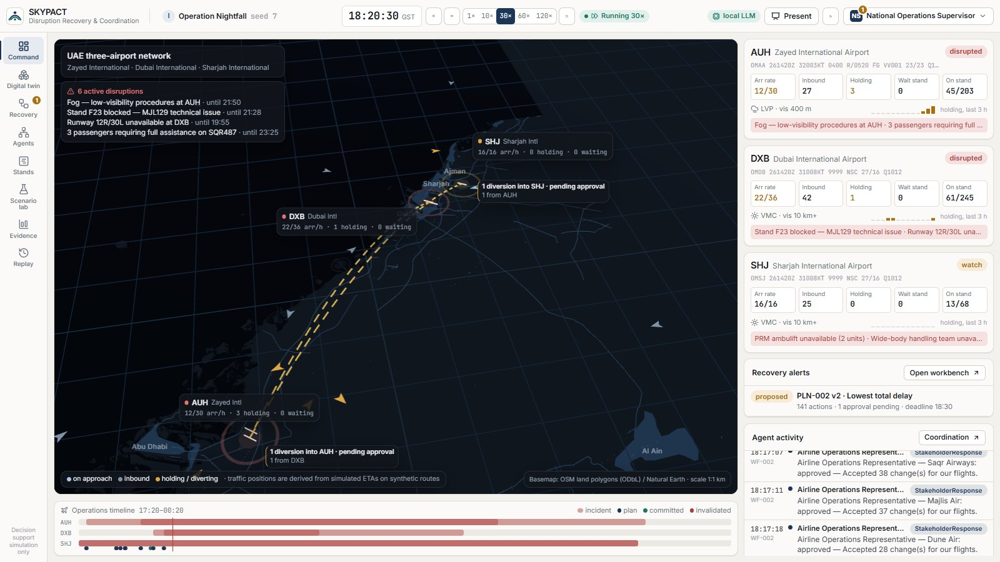

# SKYPACT — Agentic Airport Disruption Recovery & Coordination

**UAE Hackathon 2026 · Pioneers Track · Responsible AI** — GCAA challenge: *immediate, reliable decisions on aircraft
movement and landing/parking-stand allocation during fog, emergency weather and similar disruptions.*

SKYPACT is a decision-support prototype for a national operations centre that coordinates three airports as one
network: **Zayed International (OMAA/AUH)**, **Dubai International (OMDB/DXB)** and **Sharjah International
(OMSJ/SHJ)**. When fog, storms, runway closures, blocked stands or equipment outages hit, seven cooperating AI agents
assess the impact, an optimiser builds recovery plans (stand reassignments, landing slots, coordinated diversions,
tows), an independent validator checks them, and the people responsible approve them. Nothing executes without the
required human approvals, and SKYPACT never issues ATC clearances.

Everything runs **in the browser, offline**: a deterministic simulator, the agents, a HiGHS mixed-integer optimiser in
a Web Worker, approvals with a hash-chained audit log, and a 3D digital twin of each airport built from OpenStreetMap
data and original Blender models.

> All flights, airlines (11 fictional carriers) and operational numbers are **synthetic**. Airport geometry comes from
> OpenStreetMap and public aeronautical information; nothing here represents real airline or airport operational data.



<sup>Screen captures of the running prototype (Operation Nightfall, seed 7; synthetic traffic, fictional airlines).</sup>

| | |
|---|---|
|  |  |
|  |  |
|  |  |



---

## Quick start

Requirements: Node.js ≥ 20 (tested with 22), a desktop browser with WebGL 2 (Chrome, Edge or Firefox).

```bash
cd frontend
npm install
npm run dev
```

Open <http://localhost:3000>. The app boots into **Operation Nightfall** (17:20 local, paused). Press ▶ in the top bar,
or click **Present** for the guided nine-step demonstration.

For the smoothest live demo, run the production build instead of the dev server:

```bash
cd frontend
npm run build
npm start
```

Optional — local language model for the plan briefings (offline, no API key): install [Ollama](https://ollama.com),
run `ollama pull qwen2.5:3b`, and keep Ollama running. SKYPACT detects it automatically; without it, briefings fall
back to deterministic templates. Every number in an LLM briefing is checked against the plan before it is shown.

Checks:

```bash
cd frontend
npx vitest run          # simulator, optimiser, agents, approvals, audit tamper detection
npx tsc --noEmit        # types
npx eslint src          # lint
```

## What you can do

The app opens in **Simple** mode for a first-time audience: a welcome card tells the story in four steps, a
**Now** bar under the top bar says in one sentence what is happening and what to do next, the clock has just **Play**
and **Skip to next event** (fast-forward until something happens), and every view speaks plain language. **Expert**
mode (switch at the bottom of the navigation) brings back every number, log and table.

| View | Purpose |
|---|---|
| **Overview** | National map with live traffic, circling aircraft, diversion flows and what is wrong right now; a card per airport (landings per hour, planes on the way, aircraft circling), the plan that needs a decision and what the agents did. Expert adds METARs, the full agent feed and the operations timeline. |
| **3D airport** | Each airport in 3D from OpenStreetMap: liveried aircraft moving on the simulator's trajectories, docking jet bridges and turnaround vehicles, lighting from the real sun position, fog from the reported visibility, closures, gate status, taxi routes and the plan previewed in violet. Click any aircraft or gate. |
| **AI agents** | An interactive scene of the seven agents and the people who decide, in the order they act: messages fly along the links, the working agent says what it is doing, each person shows their decision. Click an agent for its job, its limits and everything it did; hover a step of the story to light up the agents involved; replay the whole conversation. Expert adds the swim-lane sequence and the log of every message and tool call (including the model sent to HiGHS). |
| **Decision** | The recovery plan in plain words — the problem if nobody acts, what the plan changes, what it should achieve against doing nothing, why it was chosen — and who has approved; your Approve / Say no buttons first. Expert adds candidates vs. baselines, every decision, validation detail, versions and the audit excerpt. |
| **Before & after** | The same evening simulated twice from the same moment: **without SKYPACT** (if nobody acts: aircraft stack up circling, crews divert on low fuel, gates clash), **the plan** the agents built and who approved it, and **with SKYPACT**, each with big numbers and the change. A chart shows both futures unfolding over four hours (planes circling, low-fuel diversions, passenger delay) with a crosshair readout and a table view, and a strip shows what each agent contributed. It works as soon as the agents have predicted the impact, while the plan awaits approval, and after approval (re-run from that moment). **Expert** turns it into the evidence view: the third baseline (each airport acting alone), optimiser statistics, provenance and the JSON evidence export. |
| **Gate plan** | Per-gate timeline: planned, actual, estimated and proposed occupancy, conflicts and technical holds. |
| **Scenarios** | Launch scenarios A–I or Nightfall, change the seed, or inject incidents (fog, storm, runway closure, blocked stand, priority arrival, diversion influx, resource outage, accessibility needs) — alone or simultaneously. |
| **Replay** | Deterministic replay of the whole run from recorded inputs; re-simulate to any time. |
| **Guided demo** | A three-minute tour that drives the real system (no staged data); interruptible at any point. |

Switch role in the top bar (National Supervisor, airport controllers, airline representative, ATC liaison): what a role
may see and decide is enforced by the runtime, not just the UI.

## How it works

```
 Browser (single page, no backend)
 ┌──────────────────────────────────────────────────────────────────────────────────────┐
 │ UI (Next.js / React)  ── views, 3D twin (React Three Fiber), presentation mode        │
 │        │ subscribes                                                                   │
 │ Runtime ── deterministic discrete-event simulator (A-CDM milestones, AMAN/DMAN,       │
 │        │   turnarounds, resources, weather, fuel-driven diversions, tows)             │
 │        ├─ Orchestrator: 7 agents with tool permissions and typed messages             │
 │        ├─ Approvals: role-based slots, staleness re-validation, SHA-256 audit chain   │
 │        └─ Compute client ──► Web Worker: HiGHS MILP + look-ahead projections          │
 └──────────────────────────────────────────────────────────────────────────────────────┘
 Offline pipelines (build time only)
   OpenStreetMap PBF ─► pipeline/osm ─► data/airports/<ICAO>/layout.json (runways, taxi graph, stands, buildings)
   Blender (headless) ─► pipeline/blender ─► GLB ─► pipeline/optimize_assets.mjs ─► frontend/public/assets
```

### The agents

| Agent | Tools | Authority |
|---|---|---|
| Weather & Disruption | read_weather, read_incidents, classify_change | publish disruption notices |
| Airport Operations | get_runway_status, get_stand_occupancy, project_operations, detect_conflicts | publish impact assessments |
| Airline Operations | get_affected_flights, estimate_downstream, get_airline_preferences | state airline constraints |
| ATC Liaison | get_arrival_capacity, check_plan_restrictions | inform authorised ATC reviewers (no clearances) |
| Recovery Planning | build_recovery_problem, run_optimizer, evaluate_plans, compare_plans | propose candidate plans |
| Validation & Safety | validate_plan, check_staleness, required_approvals | block or invalidate plans |
| Coordination | create_proposal, send_coordination_request, record_response, share_local_information, request_replan, commit_plan, escalate | route requests; commit only with every approval and a passing re-validation |

Agents are deterministic programs with explicit tools and authority boundaries; calling a tool outside an agent's
permissions throws. Their reasoning is the data they compute and log, not generated prose. Simulated stakeholders
answer from **their own local knowledge** (e.g. Sharjah's equipment log), so information the network lacks is revealed
through rejection, shared, and planned around.

### The optimiser

A time-indexed mixed-integer program per disruption, solved by HiGHS (WebAssembly) in a worker:

* decisions: home stand and landing slot per affected flight, diversion to an alternate (with stand), tows that free
  stands, or an explicit “unresolved” with reasons;
* hard constraints: stand compatibility and closures, one aircraft per stand (and per conflicting MARS stand pair)
  with buffers, 15-minute arrival capacity per airport, fuel endurance as an absolute deadline, alternate eligibility
  (size, runway, handling agreement) and acceptance limits, accessible boarding for passengers with reduced mobility,
  wide-body handling and ambulift capacity;
* three objective variants — *lowest total delay*, *stability* (fewest changes), *least coordination* — solved
  deterministically (a branch-and-bound node limit bounds the search; a wall-clock limit exists only as a safety net)
  and compared with *no action* and *local-greedy* policies by projecting the simulator forward from the same state;
  the plan's projection handles everything outside the plan exactly like the local-greedy policy.

The Validation agent re-derives every constraint independently of the optimiser before approval and again before
commit; plans whose inputs changed are marked **stale** and re-planned rather than executed.

## Scenarios

| Code | Scenario | Airports |
|---|---|---|
| I | **Operation Nightfall** — fog at AUH, runway inspection and blocked stand at DXB, passengers needing assistance, Sharjah constraints revealed only through coordination | all |
| A | Heavy fog at dawn | AUH |
| B | Thunderstorm with ramp suspensions | DXB |
| C | Arrival runway unavailable | DXB |
| D | Blocked contact stand | DXB |
| E | Priority (medical/technical) arrival | AUH |
| F | Unexpected diversion influx | SHJ |
| G | Ground-handling limitation | AUH |
| H | Accessibility-sensitive recovery | DXB |

All runs are reproducible from scenario id + seed + recorded human inputs.

## Responsible AI

* **Human authority** — every plan needs the approvals its content requires (airport controllers, affected airlines,
  ATC acknowledgement, National Supervisor). Agents cannot approve for a human, and commit re-validates first.
* **No operational overreach** — SKYPACT proposes landing-sequence targets and diversions for *authorised* ATC review;
  it issues no clearances.
* **Transparency** — every message, tool call, constraint, rejected option and reason is inspectable; the audit log is
  hash-chained and tamper-evident; runs are deterministic and replayable.
* **Honest data** — synthetic flights and fictional airlines are labelled; provenance is shown for restrictions
  (`verified_public`, `synthetic`, `derived`, `human_entered`, `stakeholder_reported`).
* **Equity of outcomes** — passengers with reduced mobility are a hard constraint (accessible boarding), not a
  weight to trade away.
* **Privacy and sovereignty** — no personal data, no cloud calls, no API keys; the optional language model runs locally.

## Repository

```
frontend/              Next.js app (all runtime logic in TypeScript)
  src/core/            simulator, agents, solver, approvals, runtime
  src/three/           national map and 3D digital twin
  src/ui/              views, workbench, agents graph, presentation mode
  public/assets/       optimised GLB models   public/data/  layouts + national basemap
pipeline/osm/          OSM → layout.json pipeline (Python, uv)
pipeline/blender/      headless Blender generators (aircraft, equipment, airports)
data/                  layouts, national basemap, researched reference facts
docs/                  conventions, data sources, demo script, pitch, business model, pilot plan
```

## Documentation

* [docs/CONVENTIONS.md](docs/CONVENTIONS.md) — coordinate frames, layout schema, asset contracts
* [docs/DATA_SOURCES.md](docs/DATA_SOURCES.md) — data sources, licences, derivation rules
* [docs/ARCHITECTURE.md](docs/ARCHITECTURE.md) — components, data flow, determinism
* [docs/DEMO_SCRIPT.md](docs/DEMO_SCRIPT.md) — three-minute demo
* [docs/PITCH.md](docs/PITCH.md), [docs/BUSINESS_MODEL_CANVAS.md](docs/BUSINESS_MODEL_CANVAS.md), [docs/PILOT_PLAN.md](docs/PILOT_PLAN.md)
* [docs/BENCHMARKS.md](docs/BENCHMARKS.md) — simulator, optimiser and validation timings on the real layouts
* [docs/LIMITATIONS.md](docs/LIMITATIONS.md) — what this prototype does not do
* [docs/ASSET_LICENSES.md](docs/ASSET_LICENSES.md) — models, textures, fonts, libraries

## Licences

Map data © OpenStreetMap contributors (ODbL 1.0). Natural Earth (public domain). Textures and HDRI from Poly Haven
(CC0). Aircraft, ground equipment and airport models are original procedural creations made for this project.
See [docs/ASSET_LICENSES.md](docs/ASSET_LICENSES.md) and [docs/DATA_SOURCES.md](docs/DATA_SOURCES.md).
